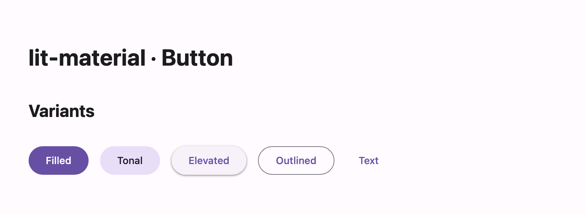

# @lit-material/button

A Material Design 3 button web component built with [Lit](https://lit.dev/). Part of
[lit-material](https://github.com/bohdaq/lit-material).



## Install

```sh
npm install @lit-material/button @lit-material/tokens
```

## Usage

```html
<link rel="stylesheet" href="node_modules/@lit-material/tokens/css/index.css" />
<script type="module">
  import "@lit-material/button";
</script>

<lit-material-button variant="filled">Save</lit-material-button>
<lit-material-button variant="outlined" disabled>Cancel</lit-material-button>
<lit-material-button variant="text" href="https://lit.dev">Docs</lit-material-button>
```

## API

| Property   | Attribute  | Type                                                             | Default    |
| ---------- | ---------- | ----------------------------------------------------------------| ---------- |
| `variant`  | `variant`  | `"filled" \| "tonal" \| "elevated" \| "outlined" \| "text"`      | `"filled"` |
| `type`     | `type`     | `"button" \| "submit" \| "reset"`                                | `"button"` |
| `disabled` | `disabled` | `boolean`                                                        | `false`    |
| `href`     | `href`     | `string`                                                         | `""`       |
| `target`   | `target`   | `string`                                                         | `""`       |
| `name`     | `name`     | `string`                                                         | `""`       |
| `value`    | `value`    | `string`                                                         | `""`       |
| `form`     | `form`     | `string \| undefined`                                            | `undefined`|

Slots: default (label), `icon` (leading icon).

`type="submit"` and `type="reset"` participate in an ancestor `<form>` via
`ElementInternals`; setting `href` renders an `<a>` instead of a `<button>`.

## Action list

`lit-material-action-list` lays out a row of actions with consistent spacing — a form's Cancel and
Save, a toolbar, a card's links — wrapping when it runs out of room.

```html
<lit-material-action-list align="end" label="Form actions">
  <lit-material-button variant="text">Cancel</lit-material-button>
  <lit-material-button>Save</lit-material-button>
</lit-material-action-list>
```

| Property  | Attribute | Type | Default |
| --------- | --------- | ---- | ------- |
| `align`   | `align` (reflected) | `"start" \| "end" \| "between"` | `"start"` |
| `compact` | `compact` (reflected) | `boolean` (4px gaps, for icon buttons) | `false` |
| `label`   | `label`   | `string` (names the row; it becomes `role="group"`) | `""` |

Nest action lists to group actions: groups sit 16px apart, actions in a group 8px. `end` and
`between` take the full width (or the rest of a flex row) so there is room to align in.
`--lit-material-action-list-gap` overrides the spacing.

## Styling

Theme the component through custom properties rather than `::part`:

| Property | Default |
| --- | --- |
| `--lit-material-button-height` | `40px` |
| `--lit-material-button-padding-inline` | `24px` (`12px` for `text`: `--lit-material-button-text-padding-inline`) |
| `--lit-material-button-shape` | `--md-sys-shape-corner-full` |
| `--lit-material-button-pressed-scale` | `1` (try `0.98`; ignored under reduced motion) |

## License

MIT
