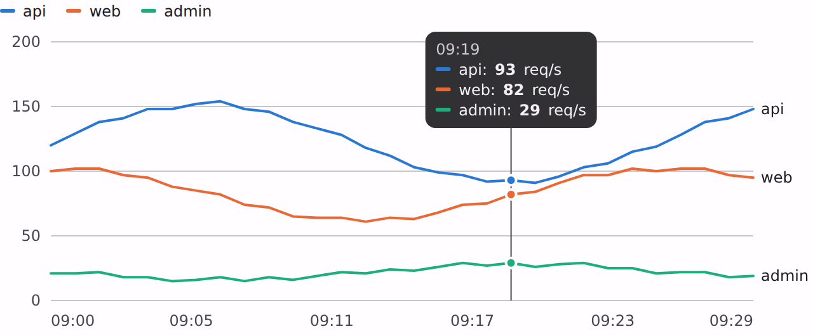

# @lit-material/chart

A line chart and a sparkline. Built with [Lit](https://lit.dev/). Part of
[lit-material](https://github.com/bohdaq/lit-material).



## Install

```sh
npm install @lit-material/chart @lit-material/tokens
```

## Usage

```html
<link rel="stylesheet" href="node_modules/@lit-material/tokens/css/index.css" />
<script type="module">
  import "@lit-material/chart";
</script>

<lit-material-line-chart id="rps" label="Requests per second, last 10 minutes" unit="req/s" height="240"></lit-material-line-chart>
<lit-material-sparkline id="spark" label="Errors" show-last></lit-material-sparkline>

<script type="module">
  const chart = document.querySelector("#rps");
  chart.series = [
    { name: "api", points: [{ x: Date.now() - 60000, y: 120 }, { x: Date.now(), y: 132 }] },
    { name: "web", points: [{ x: Date.now() - 60000, y: 80 }, { x: Date.now(), y: 76 }] },
  ];
  chart.formatX = (t) => new Date(t).toLocaleTimeString();
  document.querySelector("#spark").values = [4, 1, 7, 3];
</script>
```

## API

### `lit-material-line-chart`

| Property | Attribute | Type | Default |
| -------- | --------- | ---- | ------- |
| `series` | — | `{ name: string; points: { x: number; y: number }[] }[]` (up to 8 drawn) | `[]` |
| `label` | `label` | `string` | `""` |
| `height` | `height` | `number` (px) | `240` |
| `yMin` | `y-min` | `number \| undefined` | 0, or the data's minimum if negative |
| `unit` | `unit` | `string` | `""` |
| `formatX` / `formatY` | — | `(n: number) => string` | compact numbers |

Parts: `chart`, `legend`, `tooltip`. Series colours: `--lit-material-chart-series-1` … `-8`.

### `lit-material-sparkline`

| Property | Attribute | Type | Default |
| -------- | --------- | ---- | ------- |
| `values` | — | `number[]` | `[]` |
| `label` | `label` | `string` | `""` |
| `showLast` | `show-last` | `boolean` | `false` |
| `format` | — | `(n: number) => string` | compact numbers |

Size it with `--lit-material-sparkline-width` (96px) and `-height` (24px).

The line chart follows the usual data-visualisation rules: 2px lines, a recessive grid, one y axis (from zero unless
`y-min` says otherwise), and colours in a fixed order that's never cycled. The default palette is
the categorical one validated for colour-vision deficiency on adjacent pairs; set the
`--lit-material-chart-series-N` properties to your brand's. Two or more series get a legend; up to
four are also labelled at the end of their line. Past eight, fold the rest into "Other" or use small
multiples: extra series aren't drawn (with a console warning). It's laid out at its container's
width (640px until measured, and on the server).

## Accessibility

The chart is a focusable `role="img"` named by `label` plus a summary (latest value and range per
series). ← → (and Home / End) move a crosshair that reads every series at that x; Escape hides
it. A visually hidden data table (up to 200 rows) follows for screen readers. The sparkline states
its latest value and range in its accessible name, since it has no axes.

## License

MIT
