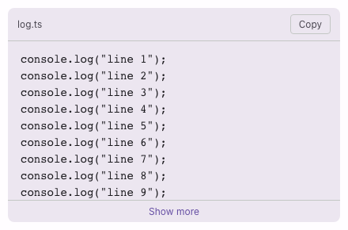

# @lit-material/code-block

Material Design 3-styled code block web component built with [Lit](https://lit.dev/). Part of
[lit-material](https://github.com/bohdaq/lit-material).

A monospace container for a block of source code — a filename/language label, a
copy-to-clipboard button, and optional truncation for long snippets.



## Install

```sh
npm install @lit-material/code-block @lit-material/tokens
```

## Usage

```html
<link rel="stylesheet" href="node_modules/@lit-material/tokens/css/index.css" />
<script type="module">
  import "@lit-material/code-block";
</script>

<lit-material-code-block label="index.ts">
  export function add(a: number, b: number): number {
    return a + b;
  }
</lit-material-code-block>

<lit-material-code-block expandable>
  <!-- a long snippet — collapses to a fixed height with a "Show more" toggle -->
</lit-material-code-block>
```

## API

| Property     | Attribute    | Type      | Default |
| ------------ | ------------ | --------- | ------- |
| `label`      | `label`      | `string`  | `""`    |
| `copyable`   | `copyable`   | `boolean` | `true`  |
| `expandable` | `expandable` | `boolean` | `false` |
| `expanded`   | `expanded`   | `boolean` | `false` |

Methods: `copy()` — writes the element's text content to the clipboard and fires `copy`.

Slot: default — the code content (plain text, or pre-highlighted markup from your own
highlighter).

Fires `copy` after `copy()` writes the code's text to the clipboard.

## Behavior

Deliberately doesn't syntax-highlight: that's a real, separate feature (tokenizing a specific
language, shipping a grammar/theme) that belongs to a dedicated highlighting library, not this
component — slot in pre-highlighted markup yourself if you need it, the same way a `<pre>` element
itself doesn't care what's inside it.

The header (label and/or copy button) only renders when there's something to put in it — no label
and `copyable="false"` together mean no header at all, not an empty band.

`expandable` clips the code to a fixed height with a "Show more"/"Show less" toggle, rather than
hiding it outright — useful for long snippets where you want a compact default without losing the
option to see everything.

## Code field

`lit-material-code-field` is the editable counterpart: a plain-text editor for YAML, JSON, a
script or a Dockerfile, with line numbers, no wrapping or spell-check.

```html
<lit-material-code-field label="values.json" language="json"></lit-material-code-field>
```

- Tab indents the caret or the selected lines, Shift+Tab outdents, Enter keeps the line's
  indentation. Escape releases Tab, so the next Tab moves focus: the keyboard is never trapped.
- `language="json"` validates as you type and shows "Line N: …" under the field; the host gets
  `invalid` and the textarea `aria-invalid` + `aria-describedby`. For YAML or anything else set
  `validator` to `(text) => message` (empty when valid), e.g. wrapping your YAML parser.
- No syntax highlighting: reach for CodeMirror or Monaco when you need it.

| Property     | Attribute     | Type                       | Default |
| ------------ | ------------- | -------------------------- | ------- |
| `value`      | `value`       | `string`                   | `""`    |
| `label`      | `label`       | `string`                   | `""`    |
| `language`   | `language`    | `string` (`"json"` checks) | `""`    |
| `validator`  | —             | `(text: string) => string` | —       |
| `indentSize` | `indent-size` | `number`                   | `2`     |
| `disabled`   | `disabled`    | `boolean`                  | `false` |
| `readonly`   | `readonly`    | `boolean`                  | `false` |
| `invalid`    | `invalid` (reflected, read it) | `boolean` | `false` |

`validationMessage` holds the current error, `checkValidity()` re-runs the check, and
`validateJson(text)` is exported. Events: `input`, `change`. Custom properties:
`--lit-material-code-field-font`, `-font-size`, `-min-height` (default `8lh`), `-max-height`
(default `24lh`). Parts: `field`, `gutter`, `textarea`, `error`.

## Styling

Theme the component through custom properties rather than `::part`:

| Property | Default |
| --- | --- |
| `--lit-material-code-block-shape` | `--md-sys-shape-corner-small` |
| `--lit-material-code-block-container-color` | `--md-sys-color-surface-container-high` |
| `--lit-material-code-block-font` | `--md-sys-typescale-code-font`, then monospace |
| `--lit-material-code-block-font-size` | `0.875rem` |
| `--lit-material-code-block-line-height` | `1.5` |
| `--lit-material-code-block-label-font` | the header's font |

## License

MIT
