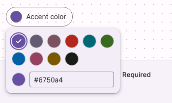

# @lit-material/color-picker

Material Design 3-styled color picker web component built with [Lit](https://lit.dev/). Part of
[lit-material](https://github.com/bohdaq/lit-material).

A swatch trigger that opens a popover holding a preset color grid, a hex text input, and a native
`<input type="color">` for arbitrary values — leaning on the platform's own color picker rather
than reimplementing a hue/saturation canvas from scratch.



## Install

```sh
npm install @lit-material/color-picker @lit-material/tokens
```

## Usage

```html
<link rel="stylesheet" href="node_modules/@lit-material/tokens/css/index.css" />
<script type="module">
  import "@lit-material/color-picker";
</script>

<lit-material-color-picker name="accent" label="Accent color" value="#6750a4"></lit-material-color-picker>
```

Custom presets:

```js
document.querySelector("lit-material-color-picker").presets = ["#ff0000", "#00ff00", "#0000ff"];
```

## API

| Property   | Attribute  | Type                   | Default          |
| ---------- | ---------- | ---------------------- | ---------------- |
| `value`    | `value`    | `string` (hex, `#rrggbb`) | `""`           |
| `label`    | `label`    | `string`                | `""`             |
| `name`     | `name`     | `string`                | `""`             |
| `required` | `required` | `boolean`               | `false`          |
| `disabled` | `disabled` | `boolean`               | `false`          |
| `open`     | `open`     | `boolean`               | `false`          |
| `form`     | `form`     | `string \| undefined`   | `undefined`      |
| `presets`  | —          | `readonly string[]`     | 10 general-purpose colors (`DEFAULT_PRESETS` export) |

Form-associated via `ElementInternals` (participates in `FormData`, validation, and form reset);
`required` makes an empty value invalid. Fires `change` when the committed value changes via user
interaction (preset click, native color input commit, or a valid hex typed into the text field).

## Keyboard interaction

Enter/Space or click on the trigger opens the panel, highlighting the preset matching the current
value (or the first preset). Once open: Arrow Right/Down and Arrow Left/Up move the highlight
among presets (no wrapping), Home/End jump to the first/last, Enter/Space (native `<button>`
behavior) select the highlighted preset and return focus to the trigger, and Escape closes the
panel without changing the value. Clicking outside the open panel closes it (native `popover="auto"`
light-dismiss) without changing the value. The hex text input and native color input are reachable
by Tab from the preset grid.

## License

MIT
