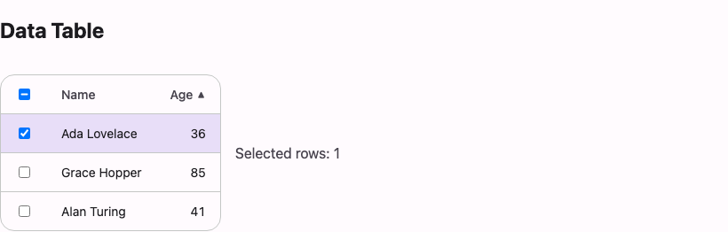

# @lit-material/data-table

Material Design 3 data table web components built with [Lit](https://lit.dev/). Part of
[lit-material](https://github.com/bohdaq/lit-material).



## Install

```sh
npm install @lit-material/data-table @lit-material/tokens
```

## Usage

```html
<link rel="stylesheet" href="node_modules/@lit-material/tokens/css/index.css" />
<script type="module">
  import "@lit-material/data-table";
</script>

<lit-material-data-table id="table">
  <lit-material-data-table-row header>
    <lit-material-data-table-cell header>
      <input type="checkbox" data-select-all aria-label="Select all rows" />
    </lit-material-data-table-cell>
    <lit-material-data-table-cell header sort-key="name">Name</lit-material-data-table-cell>
    <lit-material-data-table-cell header sort-key="age" numeric>Age</lit-material-data-table-cell>
  </lit-material-data-table-row>

  <lit-material-data-table-row data-row-id="1">
    <lit-material-data-table-cell>
      <input type="checkbox" data-row-select aria-label="Select row: Ada" />
    </lit-material-data-table-cell>
    <lit-material-data-table-cell>Ada</lit-material-data-table-cell>
    <lit-material-data-table-cell numeric>32</lit-material-data-table-cell>
  </lit-material-data-table-row>
</lit-material-data-table>

<script type="module">
  const table = document.querySelector("#table");
  table.addEventListener("sort-change", (e) => console.log(e.detail)); // { sortKey, sortDirection }
  table.addEventListener("selection-change", (e) => console.log(e.detail)); // { selected: string[] }
</script>
```

## Why not a real `<table>`?

An earlier version of this component wrapped a real `<table>`/`<thead>`/`<tbody>`, with sorting
and selection styled from the outer component's own shadow root. That doesn't work: CSS
`::slotted()` can only style a *directly* slotted node, never its descendants — so with
`<thead>`/`<tbody>` as the slotted content, individual `<th>`/`<td>` cells are unreachable from
the table's stylesheet entirely (the same wall
[`@lit-material/badge`](https://github.com/bohdaq/lit-material/tree/main/packages/badge)'s README
describes hitting from a different angle). Splitting the table into
`lit-material-data-table-row`/`-cell` sub-components — the same shape as
[`@lit-material/list`](https://github.com/bohdaq/lit-material/tree/main/packages/list)'s
list/list-item split — gives every visual unit its own shadow root to style, at the cost of using
`display: table` / `table-row` / `table-cell` instead of the real elements to still get native
column alignment.

## API

### `lit-material-data-table`

| Property        | Attribute          | Type                                     | Default       |
| ---------------- | ------------------ | ----------------------------------------- | -------------- |
| `sortKey`        | `sort-key`          | `string \| undefined`                     | `undefined`    |
| `sortDirection`  | `sort-direction`    | `"none" \| "ascending" \| "descending"`   | `"ascending"`  |
| `items`          | —                   | `readonly unknown[]`                      | `[]`           |
| `rowRenderer`    | —                   | `(item, index) => unknown` \| `undefined` | `undefined`    |
| `rowKey`         | —                   | `(item, index) => string \| number` \| `undefined` | `undefined` |
| `rowHeight`      | `row-height`        | `number`                                  | `44`           |
| `viewportHeight` | `viewport-height`   | `number`                                  | `400`          |
| `overscan`       | `overscan`          | `number`                                  | `4`            |

Slot: default (`lit-material-data-table-row` elements — in virtualized mode, the header row only).

This component owns UI *state* (which column is sorted which way, which rows are checked) and
*notifies* you of it via events — it never reorders rows or owns your data. Activating a sortable
header updates `sortKey`/`sortDirection`, syncs the indicator onto the right cell, and fires
`sort-change`; you re-render rows in the new order (or re-fetch a sorted page) in response. The
same headless-behavior split
[`@lit-material/tabs`](https://github.com/bohdaq/lit-material/tree/main/packages/tabs) makes for
tab panels.

Row selection works by event delegation rather than a hard dependency on any specific checkbox
implementation: put a real `<input type="checkbox">` (or
[`@lit-material/checkbox`](https://github.com/bohdaq/lit-material/tree/main/packages/checkbox), or
anything that fires a bubbling `change` event) with a `data-row-select` attribute in a row's cell,
and one with `data-select-all` in the header row's. Give each selectable row a `data-row-id`
attribute — `selection-change`'s `detail.selected` is the list of checked rows' `data-row-id`
values.

Fires `sort-change` (`detail: { sortKey, sortDirection }`) and `selection-change`
(`detail: { selected: string[] }`).

#### Row virtualization

Set `.items` (your full dataset) and `.rowRenderer` (a function returning one body row per item)
to switch on fixed-height virtualization — only the rows within (or near) the visible scroll window
are ever mounted, however large `items` is:

```ts
table.items = people; // e.g. 50,000 rows
table.rowRenderer = (person, index) => html`
  <lit-material-data-table-row flex data-row-id=${person.id}>
    <lit-material-data-table-cell flex width="200px">${person.name}</lit-material-data-table-cell>
    <lit-material-data-table-cell flex width="80px" numeric>${person.age}</lit-material-data-table-cell>
  </lit-material-data-table-row>
`;
```

This is the one thing here that isn't purely headless — true virtualization requires knowing the
full item count up front, which "you slot real rows" (the table's normal mode) can't provide.
Notes:

- **Slot only the header row.** Body rows come from `rowRenderer`; anything else slotted alongside
  it is ignored by the virtualized viewport (though still slotted, so don't put extra body rows
  there).
- **Both the header row and every `rowRenderer` row need `flex`** (see
  `lit-material-data-table-row`'s own docs) — virtualized rows are positioned with `transform`,
  which the table's normal `display: table` column-alignment trick can't do, so virtualized mode
  uses explicit flexbox widths (`lit-material-data-table-cell`'s `width` property) instead. Keep
  the header's cell widths and the body rows' cell widths in sync yourself.
- **Row height is fixed** — set `row-height` to whatever your actual row content needs; there's no
  per-row measurement.
- Sorting and row-selection delegation both keep working on virtualized rows exactly as they do on
  slotted ones.

**Density.** `density="compact"` (reflected) sets the cells' padding to 6px × 12px instead of
12px × 16px, for dense tools. Any other spacing: `--lit-material-data-table-cell-padding-block` and
`--lit-material-data-table-cell-padding-inline` on the table.

### `lit-material-data-table-row`

| Property   | Attribute  | Type      | Default |
| ---------- | ---------- | --------- | ------- |
| `header`   | `header`   | `boolean` | `false` |
| `selected` | `selected` | `boolean` | `false` |
| `flex`     | `flex`     | `boolean` | `false` |

Slot: default (`lit-material-data-table-cell` elements). Set `header` on the row made up of
header cells (typically the first). `selected` is normally managed by the parent table from a
`data-row-select` checkbox's checked state, not set directly. Set `flex` to switch the row from
`display: table-row` to `display: flex` — only needed for virtualized rows (see above).

### `lit-material-data-table-cell`

| Property        | Attribute         | Type                                    | Default |
| ---------------- | ------------------ | ----------------------------------------- | ------- |
| `header`         | `header`            | `boolean`                                  | `false` |
| `numeric`        | `numeric`           | `boolean`                                  | `false` |
| `sortKey`        | `sort-key`          | `string \| undefined`                     | `undefined` |
| `sortDirection`  | `sort-direction`    | `"none" \| "ascending" \| "descending"`   | `"none"` |
| `resizable`      | `resizable`         | `boolean`                                  | `false` |
| `minWidth`       | `min-width`         | `number`                                   | `60`    |
| `flex`           | `flex`              | `boolean`                                  | `false` |
| `width`          | `width`             | `string \| undefined`                     | `undefined` |

Slot: default (the cell's content). `numeric` right-aligns content (and applies tabular figures)
— use it for numeric columns per the MD3 spec. Set `sort-key` on a `header` cell to make it
sortable: that wraps its content in a real `<button>` (the ARIA APG pattern for sortable column
headers is an interactive element *inside* the columnheader cell, not the cell itself carrying the
interaction). `sortDirection` is kept in sync by the parent table, not set directly.

Set `resizable` on a `header` cell to add a drag handle at its trailing edge; dragging it fires
`column-resize` (`detail: { width }`, pixels) on the cell, which `lit-material-data-table` listens
for and applies to every cell in that column (not just the header one — see the table's own docs
for why). `min-width` floors how narrow a drag can make it. `flex`/`width` are for virtualized mode
— see the table's docs above.

Fires `column-resize` (`detail: { width: number }`) while dragging a `resizable` cell's handle.

The array properties above also take a JSON attribute, so markup rendered on the server carries the data and hydrates to the same output.

## Accessibility

Built entirely on ARIA `table`/`row`/`columnheader`/`cell` roles (set automatically — the
underlying elements aren't real `<table>`/`<tr>`/`<th>`/`<td>`, see above for why) rather than
requiring you to wire them up. Row-select and select-all checkboxes need their own `aria-label` (a
bare checkbox has no accessible name of its own) — see the usage example above.

## Pagination

`lit-material-data-table-pagination` is a standalone footer control, not something the table
renders itself — pagination is exactly as data-shaped a concern as sorting/selection, and the
table never owns your data (see above). Feed it a total row count and it works out page count,
range, and button disabled-state itself:

```html
<lit-material-data-table-pagination id="pager" total="97" page-size="10"></lit-material-data-table-pagination>
<script type="module">
  document.querySelector("#pager").addEventListener("page-change", (e) => {
    console.log(e.detail); // { page, pageSize } — re-slice or re-fetch your rows in response
  });
</script>
```

| Property          | Attribute    | Type                  | Default        |
| ------------------ | ------------ | ----------------------- | -------------- |
| `page`             | `page`       | `number`                | `0` (0-based)  |
| `pageSize`         | `page-size`  | `number`                | `10`           |
| `total`            | `total`      | `number`                | `0`            |
| `pageSizeOptions`  | `page-size-options` (JSON)            | `readonly number[]`     | `[10, 25, 50]` |
| `unknownTotal`     | `unknown-total` | `boolean`            | `false`        |
| `hasMore`          | `has-more`   | `boolean`               | `false`        |
| `disabled`         | `disabled` (reflected) | `boolean`     | `false`        |

Fires `page-change` (`detail: { page, pageSize }`) when a nav button is clicked or the page-size
select changes (which also resets `page` back to `0`).

Its texts ("Rows per page", "1–10 of 97", "Page N", the buttons' names and its own "Pagination"
label) are translated through `@lit-material/core`'s `registerTranslation` (keys `dataTable.*`), and
its numbers are formatted for the element's language. In right-to-left layouts the first/previous/
next/last icons are mirrored.

### Server-side and cursor paging

For an API that returns a total, set `total` and fetch on `page-change`. For a cursor-paged API
(Kubernetes `limit` + `continue`, a `next_cursor`) the total is unknown: set `unknown-total`, and
`has-more` while the response carries a next cursor. The footer shows "Page N", drops Last, and
enables Next only while `has-more` is set. Remember each page's cursor to go back; set `disabled`
while a request is in flight.

```js
const cursors = [""]; // cursors[n] fetches page n
pager.addEventListener("page-change", async ({ detail: { page, pageSize } }) => {
  if (page === 0) cursors.length = 1; // page-size change restarts
  pager.disabled = true;
  const res = await fetch(`/api/pods?limit=${pageSize}&continue=${cursors[page]}`).then((r) => r.json());
  cursors[page + 1] = res.metadata.continue ?? "";
  table.rows = res.items;
  pager.hasMore = Boolean(res.metadata.continue);
  pager.disabled = false;
});
```

The footer works under `lit-material-table` too; it never touches the table.

## Data grid

`lit-material-data-grid` is the data-driven sibling: give it `columns` and `rows` and it sorts,
groups (with aggregates), edits cells in place, selects, pages and exports CSV. It renders with the
same `lit-material-data-table`/`-row`/`-cell` elements, so it looks the same. Where
`lit-material-data-table` leaves your data to you, the grid keeps a copy, which grouping, editing
and export need; edits produce a new `rows` array and events, so you can save them.

```js
import "@lit-material/data-table/data-grid.js"; // its own entry point: it brings the editors with it
```

```html
<lit-material-data-grid id="grid" label="Employees" row-key="id" group-by="team" selectable page-size="25"></lit-material-data-grid>
<script type="module">
  const grid = document.querySelector("#grid");
  grid.columns = [
    { key: "name", header: "Name", sortable: true, editable: true },
    { key: "team", header: "Team", sortable: true },
    { key: "role", header: "Role", editable: true, editor: "select",
      options: [{ value: "eng", label: "Engineer" }, { value: "mgr", label: "Manager" }] },
    { key: "salary", header: "Salary", numeric: true, sortable: true, editable: true, aggregate: "sum",
      format: (value) => (value == null ? "" : `$${value.toLocaleString()}`) },
  ];
  grid.rows = await fetch("/api/employees").then((r) => r.json());

  grid.addEventListener("cell-edit", (e) => {
    if (e.detail.column === "salary" && !(e.detail.value >= 0)) {
      e.detail.error = "Enter a salary of 0 or more";
      e.preventDefault(); // the editor stays open with this message
    }
  });
  grid.addEventListener("edit-commit", (e) => save(e.detail.row));
  exportButton.addEventListener("click", () => grid.downloadCSV("employees.csv", { rows: "selected" }));
</script>
```

`columns` and `rows` (and `group-by`, `expanded-groups`, `selected`) also take JSON attributes, so
a server-rendered page carries the data and hydrates to the same markup. `format` and function
aggregates can only be set as properties.

### Keyboard

| Key | Does |
| --- | --- |
| Tab | Moves into the grid (one cell is in the tab order) and out again |
| Arrow keys | Move between cells (left/right flip in right-to-left layouts) |
| Home / End | First / last cell of the row; with Ctrl, of the grid |
| Page Up / Page Down | Ten rows up / down |
| Enter or Space on a sortable header | Sorts by it (again: reverses) |
| Right / Left on a group's first cell | Expands / collapses it (Enter and Space toggle too) |
| Left on a row's first cell | Moves to its group |
| Enter, F2 or double-click on an editable cell | Opens the editor |
| Enter (in the editor) | Commits and returns to the cell |
| Tab / Shift+Tab (in the editor) | Commits and opens the next / previous editable cell |
| Escape (in the editor) | Cancels |

Moving focus out of an open editor (a click elsewhere) commits it. In the `select` editor, Space or
ArrowDown open the list; while it's open the keys belong to it (Enter picks an option, Escape
closes the list), then Enter commits.

### API

| Property | Attribute | Type | Default |
| -------- | --------- | ---- | ------- |
| `columns` | `columns` (JSON) | `DataGridColumn[]` | `[]` |
| `rows` | `rows` (JSON) | `object[]` | `[]` |
| `rowKey` | `row-key` | `string \| undefined` — the field that identifies a row; else its index | `undefined` |
| `label` | `label` | `string` — the grid's accessible name | `""` ("Data grid") |
| `sortKey` | `sort-key` | `string \| undefined` | `undefined` |
| `sortDirection` | `sort-direction` | `"ascending" \| "descending"` | `"ascending"` |
| `groupBy` | `group-by` | `string[]` — `"team"`, `"team,role"` or a JSON array; nested in order | `[]` |
| `expandedGroups` | `expanded-groups` (JSON) | `string[]` — group ids; groups start collapsed | `[]` |
| `selectable` | `selectable` (reflected) | `boolean` — adds a checkbox column | `false` |
| `selected` | `selected` (JSON) | `string[]` — selected row keys | `[]` |
| `pageSize` | `page-size` | `number` — `0` shows every row, no footer | `0` |
| `page` | `page` | `number` (0-based) | `0` |
| `pageSizeOptions` | `page-size-options` (JSON) | `number[]` | `[10, 25, 50]` |

`DataGridColumn`:

| Field | Type | |
| ----- | ---- | - |
| `key` | `string` | The row field, and the column's id. |
| `header` | `string` | Header text; also the editor's label. |
| `numeric` | `boolean` | End-aligned, tabular figures; the default editor becomes `number`. |
| `sortable` | `boolean` | The header sorts by this column. |
| `editable` | `boolean` | Cells can be edited. Other cells get `aria-readonly`. |
| `editor` | `"text" \| "number" \| "select"` | `lit-material-text-field`, `lit-material-number-field` or `lit-material-select`. |
| `options` | `(string \| number \| { value, label })[]` | Choices for `select`; a cell without `format` shows the label. The committed value keeps the option's type. |
| `format` | `(value, row) => string \| number \| TemplateResult` | Display text. `row` is `null` for an aggregate. |
| `aggregate` | `"sum" \| "avg" \| "min" \| "max" \| "count" \| (values, rows) => unknown` | Shown in group header rows, over every row in the group. |
| `width` | `string \| number` | CSS length or pixels, on the header cell. |

Without `format`, numbers and dates are formatted for the element's language. Sorting compares
numbers, dates and booleans by value and text with the language's collation (numeric-aware, so
"item 2" comes before "item 10"); empty values sort last. When sorting by the column you group by,
the groups follow the sort direction too.

Methods:

- `toCSV(options?)` — the grid as CSV text, see below.
- `downloadCSV(filename = "data.csv", options?)` — saves `toCSV()` as a file (with a byte order mark unless `bom: false`).
- `expandAll()`, `collapseAll()`, `toggleGroup(id, force?)` — `toggleGroup` fires `group-toggle`; the other two only set `expandedGroups`.
- `startEdit(rowKey, columnKey)`, `commitEdit()` (returns `false` when the editor stays open), `cancelEdit()`.
- `LitMaterialDataGrid.groupId(values)` — a group's id from its values, outermost first:
  `groupId(["Platform", "Berlin"])` is `"Platform/Berlin"` (each value URI-encoded, so `/` in a value is safe).

Events (all bubble and are composed):

| Event | `detail` | When |
| ----- | -------- | ---- |
| `sort-change` | `{ sortKey, sortDirection }` | A sortable header is activated. |
| `selection-change` | `{ selected: string[] }` | A row or the select-all checkbox changes. |
| `group-toggle` | `{ group, expanded, expandedGroups }` | A group is expanded or collapsed by the user (or `toggleGroup`). |
| `cell-edit` | `{ row, column, value, oldValue, error? }` | Cancelable, before an edit is applied. `preventDefault()` keeps the editor open and shows `detail.error` (or "Invalid value"); a listener may also replace `detail.value` to normalise it. Not fired when the value didn't change, or the number editor holds something that isn't a number (it says so itself). |
| `edit-commit` | `{ row, previousRow, column, value, oldValue }` | After `rows` holds the new row (a new object; the array is new too). |
| `page-change` | `{ page, pageSize }` | From the pagination footer. |

`cell-edit` is synchronous: to validate against a server, prevent it, check, and then set `rows`
yourself.

### Grouping and ARIA

Without `group-by` the grid has the ARIA `grid` role; with it, `treegrid`. Group header rows carry
`aria-level`, `aria-expanded`, `aria-setsize` and `aria-posinset`, and so do the rows inside them
(their level is one deeper than their group's). Each group header row shows a button (with
`aria-expanded`) holding the group's column, value and row count, and the columns' aggregates in
their own cells: "Sum: 1,234", "Average: …", "Min: …", "Max: …", "Count: …" (non-empty values), or
your function's result. Collapsed rows aren't rendered. Selectable grids set `aria-multiselectable`
and `aria-selected` on rows; with `page-size`, rows carry `aria-rowindex` and the grid
`aria-rowcount`. Sorting and edit errors are announced through a polite live region.

### CSV export

`toCSV({ columns?, rows?, bom?, delimiter?, raw?, header?, escapeFormulas? })` returns RFC 4180
text: records separated by CRLF, and a field quoted when it holds the delimiter, a quote, CR or LF
(quotes inside it doubled).

- `columns` — column keys to export, in order (default: all).
- `rows` — `"all"` (default: every row, in display order, whatever is collapsed or paged),
  `"visible"` (the rows on screen: expanded groups, current page) or `"selected"`.
- Values go through `format` unless `raw: true`; a `format` that returns a template exports the
  raw value. Group header rows are never exported.
- `delimiter` — default `","` (use `";"` for spreadsheets that use a decimal comma), `bom` — a
  UTF-8 byte order mark for Excel (default `false` here, `true` for `downloadCSV`), `header` — the
  header record (default `true`).
- **Formula injection.** A cell starting with `=`, `+`, `-`, `@`, a tab or a carriage return would
  run as a formula when the file is opened in a spreadsheet, so it's written with a leading `'`
  (`=HYPERLINK(…)` becomes `'=HYPERLINK(…)`), which spreadsheets show as text. Plain numbers such as
  `-5` or `+1` are left alone. Pass `escapeFormulas: false` for a file only programs will read.

The same helpers are exported for your own use: `toCsvText(records, options)`, `csvField(text)` and
`neutralizeFormula(text)` from `@lit-material/data-table/csv.js`.

### Pagination

Set `page-size` and the grid renders `lit-material-data-table-pagination` under itself and pages its
rows, firing `page-change`. With grouping, a page is a slice of the visible rows (group header rows
count), and aggregates are over the whole group, not the page.

### Texts and direction

The grid's texts (aggregate labels, row counts, "(Empty)" for a blank group value, "No rows",
checkbox names, the announcements and "Invalid value") are translated through `@lit-material/core`'s
`registerTranslation` (keys `dataTable.*`). In right-to-left layouts the arrow keys follow the
reading direction and the group chevron is mirrored.

## Scope

Deliberately out of scope for `lit-material-data-table`: column reordering and multi-column sort.
Both reasonable follow-ups, not silently missing pieces.

For `lit-material-data-grid`, not (yet) included:

- **Virtualization.** Every rendered row is in the DOM; use `page-size` for large data, or
  `lit-material-data-table`'s virtualized mode (without grouping/editing). Roving focus and editing
  across unmounted rows need more than the table's fixed-height window.
- **Multi-column sort, filtering, column resizing/reordering/pinning** and a sticky header.
- **Editing:** no type-to-edit (start typing on a cell), no editors beyond text/number/select, no
  async `cell-edit` validation (prevent, check, then set `rows`), no undo. Editing a row's
  `row-key` field isn't supported.
- **Grouping:** group rows have no checkbox (selecting a group's rows), and group headers aren't
  repeated at the top of a page that starts inside a group.
- **CSV import**, and export of anything but the grid's own rows.

## License

MIT
