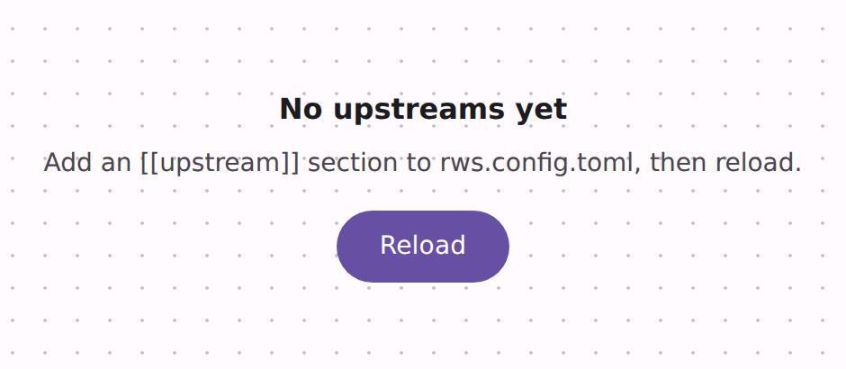

# @lit-material/empty-state

An empty state: what a view would show, and how to get there, in place of a blank panel. Built with [Lit](https://lit.dev/). Part of
[lit-material](https://github.com/bohdaq/lit-material).



## Install

```sh
npm install @lit-material/empty-state @lit-material/tokens
```

## Usage

```html
<link rel="stylesheet" href="node_modules/@lit-material/tokens/css/index.css" />
<script type="module">
  import "@lit-material/empty-state";
</script>

<lit-material-empty-state headline="No upstreams yet">
  <svg slot="icon">…</svg>
  Add an [[upstream]] section to rws.config.toml, then reload.
  <lit-material-button slot="actions">Reload</lit-material-button>
</lit-material-empty-state>

<!-- Inside a card or a table: start-aligned, dashed border. -->
<lit-material-empty-state size="compact" headline="No feature flags">
  Flags appear here once the application registers them.
</lit-material-empty-state>
```

## API

| Property | Attribute | Type | Default |
| -------- | --------- | ---- | ------- |
| `headline` | `headline` | `string` | `""` |
| `level` | `level` | `number` (1–6, clamped) | `2` |
| `size` | `size` (reflected) | `"standard" \| "compact"` | `"standard"` |

Slots: default (guidance text), `icon`, `actions`. Parts: `empty-state`, `headline`.

Empty icon and action areas collapse once the component sees nothing is slotted there (after
hydration on the server-rendered path, which can't see light DOM; until then they only cost a
gap).

## Accessibility

The headline is a heading (`role="heading"`, `aria-level` from `level`), so the empty view keeps
its place in the page outline. Pick `level` to fit where it sits.

## License

MIT
