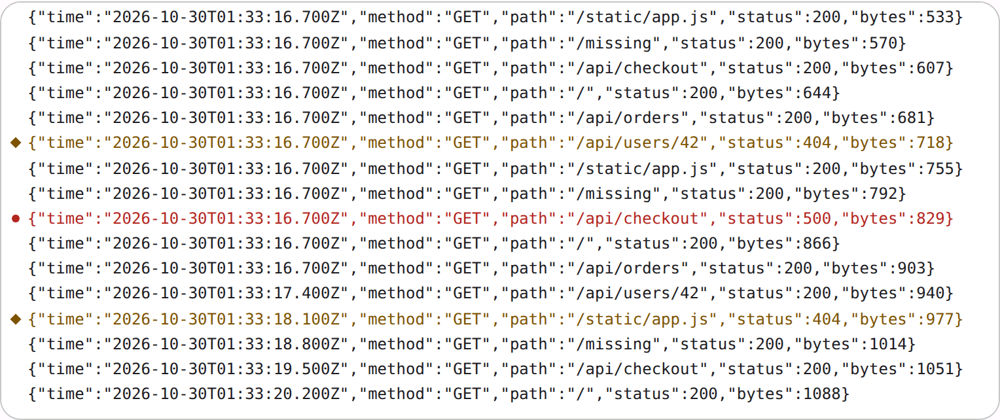

# @lit-material/log-viewer

A log viewer: a monospace stream of lines, newest at the bottom. Built with [Lit](https://lit.dev/). Part of
[lit-material](https://github.com/bohdaq/lit-material).



## Install

```sh
npm install @lit-material/log-viewer @lit-material/tokens
```

## Usage

```html
<link rel="stylesheet" href="node_modules/@lit-material/tokens/css/index.css" />
<script type="module">
  import "@lit-material/log-viewer";
</script>

<lit-material-log-viewer id="log" label="Access log" max-lines="1000"></lit-material-log-viewer>

<script type="module">
  const log = document.querySelector("#log");
  log.highlight = (line) => (/"status":5\d\d/.test(line) ? "error" : /"status":4\d\d/.test(line) ? "warning" : null);
  log.appendLines(["GET / 200", "GET /missing 404"]);
  // Pause, read, resume: held lines are added on resume.
  log.paused = true;
</script>
```

## API

| Property | Attribute | Type | Default |
| -------- | --------- | ---- | ------- |
| `maxLines` | `max-lines` | `number` | `1000` |
| `paused` | `paused` (reflected) | `boolean` | `false` |
| `wrap` | `wrap` (reflected) | `boolean` | `false` |
| `label` | `label` | `string` | `"Log"` |
| `highlight` | — | `(line: string) => "error" \| "warning" \| "info" \| null \| undefined` | `undefined` |
| `lines` | — | `string[]` (set to replace everything) | `[]` |

Methods: `appendLines(line | lines)` (strings with newlines are split), `clear()`, `scrollToLatest()`.
Event: `lines-dropped` (`detail: { count }`) when `max-lines` dropped old lines. Parts: `viewport`,
`line`, `jump`. Custom properties: `--lit-material-log-viewer-height` (320px),
`-font`, `-font-size`, `-error-color`, `-warning-color`, `-info-color`.

It follows the newest line only while you're at the bottom: scroll up to read and it stays put,
with a "N new lines" button to jump back. While `paused`, new lines wait (up to `max-lines`) and
are added on resume.

## Accessibility

The viewport is a `role="log"` region named by `label`, focusable so it scrolls from the
keyboard. It isn't announced live (`aria-live="off"`): a busy log read aloud line by line is
unusable. Highlighted lines carry a gutter marker with a different shape per level and an
`aria-label` naming it, so the level never rests on colour.

## License

MIT
