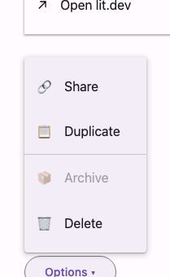

# @lit-material/menu

A Material Design 3 menu web component built with [Lit](https://lit.dev/) on top of the native
[Popover API](https://developer.mozilla.org/en-US/docs/Web/API/Popover_API). Part of
[lit-material](https://github.com/bohdaq/lit-material).



Menu items are just [`@lit-material/list`](https://github.com/bohdaq/lit-material/tree/main/packages/list)'s
`lit-material-list-item` — this package only adds positioning, open/close lifecycle, and keyboard
navigation on top.

## Install

```sh
npm install @lit-material/menu @lit-material/list @lit-material/tokens
```

## Usage

```html
<link rel="stylesheet" href="node_modules/@lit-material/tokens/css/index.css" />
<script type="module">
  import "@lit-material/menu";
  import "@lit-material/list";
</script>

<button id="trigger">Options</button>

<lit-material-menu anchor="trigger">
  <lit-material-list-item interactive>Share</lit-material-list-item>
  <lit-material-list-item interactive>Duplicate</lit-material-list-item>
  <lit-material-list-item interactive disabled>Archive</lit-material-list-item>
  <lit-material-list-item interactive>Delete</lit-material-list-item>
</lit-material-menu>

<script type="module">
  const trigger = document.getElementById("trigger");
  const menu = document.querySelector("lit-material-menu");
  trigger.addEventListener("click", () => menu.show());
</script>
```

Or anchor to an element you don't want to give an id — pass it directly:

```js
menu.show(trigger); // same as menu.anchorElement = trigger; menu.open = true
```

A context menu: call `showForEvent` from the `contextmenu` listener. It opens at the pointer and
waits for the right button's release on systems that fire the event while it's still down (opening
at once there, the release would close the menu).

```js
row.addEventListener("contextmenu", (event) => menu.showForEvent(event));
```

In a right-to-left layout the menu lines up its right edge with the anchor's (or opens leftwards
from the pointer).

## API

| Property | Attribute | Type      | Default     |
| -------- | --------- | --------- | ----------- |
| `open`   | `open`    | `boolean` | `false`     |
| `anchor` | `anchor`  | `string`  | `undefined` |

| Property/Method            | Description                                                          |
| ---------------------------- | ------------------------------------------------------------------------ |
| `anchorElement` (get/set)    | The element to position against and return focus to. Overrides `anchor` when set directly. |
| `show(anchorElement?)`        | Opens the menu, optionally setting `anchorElement` for this call.        |
| `showForEvent(event)` | For a `contextmenu` listener: opens at the pointer (under the element for the context menu key), after the right button's release where needed. |
| `close()`                     | Closes the menu (`open = false`).                                        |

Built on the native Popover API (`popover="auto"`), so top-layer rendering and light dismiss
(outside click, Escape) come from the browser. Opening the menu focuses the menu itself rather
than the first item, so nothing looks pre-selected — Arrow Down/Up from that neutral state still
land on the first/last item respectively, and continue to move focus among interactive,
non-disabled `lit-material-list-item` children from there (wrapping at the ends); Home/End jump to
the first/last directly. Activating an item (click or Enter/Space on an interactive item) closes
the menu — call `event.stopPropagation()` in your own item click handler if you need a menu that
stays open after an item is activated. A `close` event fires whenever the menu closes, for any
reason.

Because items carry `role="listitem"` (not `menuitem`), the menu itself takes `role="list"` rather
than the ARIA `menu` role — this is a floating, keyboard-navigable list built from
`lit-material-list-item`, not a strict ARIA menu/menuitem widget.

## App launcher

`lit-material-app-launcher` is a grid button for a top bar that opens a menu of the other apps a
person can go to. Items are `lit-material-list-item`s with `href`.

```html
<lit-material-app-launcher searchable>
  <lit-material-list-item href="https://grafana.example.com">Grafana
    <span slot="supporting-text">Dashboards and alerts</span></lit-material-list-item>
  <lit-material-list-item href="/billing">Billing portal</lit-material-list-item>
</lit-material-app-launcher>
```

| Property      | Attribute      | Type      | Default                   |
| ------------- | -------------- | --------- | ------------------------- |
| `label`       | `label`        | `string` (names the button and menu) | `"Applications"`, translated |
| `searchable`  | `searchable` (reflected) | `boolean` (a filter field at the top) | `false` |
| `searchLabel` | `search-label` | `string`  | `"Search applications"`, translated |
| `emptyText`   | `empty-text`   | `string` (shown when nothing matches) | `"No applications match"`, translated |
| `open`        | `open` (reflected) | `boolean` | `false` |

`show()`/`close()`; `close` fires after it closes. Slot `icon` replaces the grid icon; parts
`button`, `menu`, `search`. The filter matches an item's text and hides the rest (arrow keys skip
them); it resets when the menu closes. Since this release `lit-material-menu` also finds items
passed through nested slots and skips hidden ones.

## License

MIT
