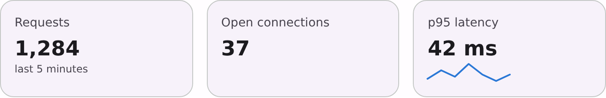

# @lit-material/stat

A stat tile: what's measured, its value large, and a caption or trend under it. Built with [Lit](https://lit.dev/). Part of
[lit-material](https://github.com/bohdaq/lit-material).



## Install

```sh
npm install @lit-material/stat @lit-material/tokens
```

## Usage

```html
<link rel="stylesheet" href="node_modules/@lit-material/tokens/css/index.css" />
<script type="module">
  import "@lit-material/stat";
</script>

<lit-material-stat label="Requests" value="1,284" caption="last 5 minutes"></lit-material-stat>

<lit-material-stat
  label="Error rate"
  value="0.04%"
  trend="down"
  trend-label="-0.02 pt since yesterday"
  trend-sentiment="positive"
></lit-material-stat>

<!-- Rich caption content: a sparkline (@lit-material/chart) beside the number. -->
<lit-material-stat label="p95 latency" value="42 ms" variant="filled">
  <lit-material-sparkline slot="caption" label="p95 latency" id="p95"></lit-material-sparkline>
</lit-material-stat>
<script type="module">
  document.querySelector("#p95").values = [40, 44, 41, 42];
</script>
```

## API

| Property | Attribute | Type | Default |
| -------- | --------- | ---- | ------- |
| `label` | `label` | `string` | `""` |
| `value` | `value` | `string` | `""` |
| `caption` | `caption` | `string` | `""` |
| `trend` | `trend` | `"up" \| "down" \| "flat" \| undefined` | `undefined` |
| `trendLabel` | `trend-label` | `string` | `""` |
| `trendSentiment` | `trend-sentiment` | `"positive" \| "negative" \| "neutral"` | `"neutral"` |
| `variant` | `variant` (reflected) | `"outlined" \| "filled" \| "plain"` | `"outlined"` |

Slots: `icon` (beside the label), `caption` (replaces the `caption` text). Parts: `stat`, `label`,
`value`, `caption`. Custom properties: `--lit-material-stat-value-font`, `-value-size`, `-value-line-height`,
`-value-weight`, `-positive-color`, `-negative-color`.

The value is text you format, shown in tabular figures so a refreshing number doesn't jitter.
A trend is shown only with `trend-label`: the arrow alone says nothing about how much. Whether up
is good depends on the metric, so the colour comes from `trend-sentiment`, not the direction.

## Accessibility

The tile is a `role="group"` named by its label, so it reads as "Requests, group, 1,284, last 5
minutes". The trend arrow is `aria-hidden`; its words carry the meaning.

## License

MIT
