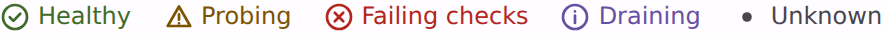

# @lit-material/status

A status indicator: an icon and a short label coloured by state. Built with [Lit](https://lit.dev/). Part of
[lit-material](https://github.com/bohdaq/lit-material).



## Install

```sh
npm install @lit-material/status @lit-material/tokens
```

## Usage

```html
<link rel="stylesheet" href="node_modules/@lit-material/tokens/css/index.css" />
<script type="module">
  import "@lit-material/status";
</script>

<lit-material-status status="ok">Healthy</lit-material-status>
<lit-material-status status="warning">Probing</lit-material-status>
<lit-material-status status="error">Failing checks</lit-material-status>
<lit-material-status status="info">Draining</lit-material-status>
<lit-material-status>Unknown</lit-material-status>

<!-- Your own icon instead of the built-in glyph. -->
<lit-material-status status="ok"><svg slot="icon">…</svg>Synced</lit-material-status>
```

## API

| Property | Attribute | Type | Default |
| -------- | --------- | ---- | ------- |
| `status` | `status` (reflected) | `"ok" \| "warning" \| "error" \| "info" \| "neutral"` | `"neutral"` |

Slots: default (the label), `icon` (replaces the glyph). Parts: `status`, `icon`.

| Custom property | Default |
| --------------- | ------- |
| `--lit-material-status-ok-color` | a green for the surface |
| `--lit-material-status-warning-color` | an amber for the surface |
| `--lit-material-status-error-color` | `--md-sys-color-error` |
| `--lit-material-status-info-color` | `--md-sys-color-primary` |
| `--lit-material-status-neutral-color` | `--md-sys-color-on-surface-variant` |

An unknown `status` renders as `neutral`. The glyphs are drawn by the component, so the package ships no icon set.

## Accessibility

Colour is never the only signal: each state has its own glyph (check, triangle, cross, "i", dot)
and the label says it in words, so it reads in grayscale, for colour-blind users and in
forced-colors mode (where it switches to `CanvasText`). The glyph is `aria-hidden`; the label is
the text screen readers read.

It's text, not a live region. For a status that changes while someone looks at it and should be
announced, wrap it in your own `role="status"` element.

## License

MIT
