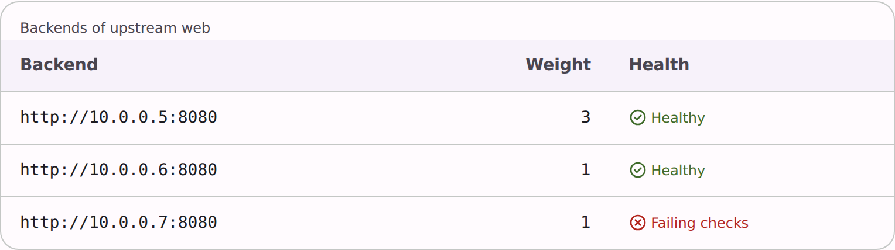

# @lit-material/table

A semantic, read-only table from data: a real `<table>`, with a caption, column headers, numeric and monospace columns, and a scroll container. Built with [Lit](https://lit.dev/). Part of
[lit-material](https://github.com/bohdaq/lit-material).



## Install

```sh
npm install @lit-material/table @lit-material/tokens
```

## Usage

```html
<link rel="stylesheet" href="node_modules/@lit-material/tokens/css/index.css" />
<script type="module">
  import "@lit-material/table";
</script>

<lit-material-table id="backends" caption="Backends" density="compact"></lit-material-table>

<script type="module">
  import { html } from "lit";
  const table = document.querySelector("#backends");
  table.columns = [
    { key: "url", label: "Backend", mono: true },
    { key: "weight", label: "Weight", numeric: true },
    { key: "action", label: "Action", hiddenLabel: true, render: (row) => html`<button>Drain</button>` },
  ];
  table.rows = [
    { url: "http://10.0.0.5:8080", weight: 3 },
    { url: "http://10.0.0.6:8080", weight: 1 },
  ];
</script>
```

## API

| Property | Attribute | Type | Default |
| -------- | --------- | ---- | ------- |
| `columns` | — | `TableColumn[]` | `[]` |
| `rows` | — | `Row[]` | `[]` |
| `caption` | `caption` | `string` | `""` |
| `captionHidden` | `caption-hidden` | `boolean` | `false` |
| `density` | `density` (reflected) | `"standard" \| "compact"` | `"standard"` |
| `stickyHeader` | `sticky-header` (reflected) | `boolean` | `false` |

`TableColumn`: `key`, `label`, `numeric?`, `mono?`, `hiddenLabel?`, `render?(row)`. Slot: `empty`
(shown instead of the body when `rows` is empty). Parts: `container`, `table`.

For sorting, selection, pagination or column resizing, use
[`@lit-material/data-table`](https://github.com/bohdaq/lit-material/tree/main/packages/data-table).
This one shows rows plainly, as a real table.

## Accessibility

It renders a real `<table>`, so screen readers announce rows, columns and headers; headers have
`scope="col"`, and `caption` names the table (`caption-hidden` keeps it for screen readers only).
A column with `hiddenLabel` still has a header for assistive technology.

## License

MIT
