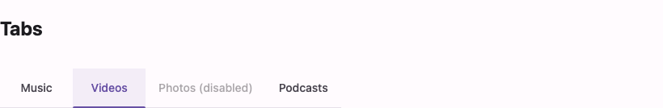

# @lit-material/tabs

A Material Design 3 tabs web component built with [Lit](https://lit.dev/). Part of
[lit-material](https://github.com/bohdaq/lit-material).



## Install

```sh
npm install @lit-material/tabs @lit-material/tokens
```

## Usage

```html
<link rel="stylesheet" href="node_modules/@lit-material/tokens/css/index.css" />
<script type="module">
  import "@lit-material/tabs";
</script>

<lit-material-tabs>
  <lit-material-tab>Music</lit-material-tab>
  <lit-material-tab>Videos</lit-material-tab>
  <lit-material-tab disabled>Photos</lit-material-tab>
</lit-material-tabs>
```

Listen for `change` to react to the selection:

```js
document.querySelector("lit-material-tabs").addEventListener("change", (event) => {
  console.log(event.target.selected); // the selected index
});
```

## API

### `lit-material-tabs`

| Property   | Attribute  | Type     | Default |
| ---------- | ---------- | -------- | ------- |
| `selected` | `selected` | `number` | `0`     |

Fires `change` (bubbling) when the selected tab changes via user interaction (click or arrow
keys) — not when `selected` is set programmatically.

### `lit-material-tab`

| Property       | Attribute       | Type      | Default |
| -------------- | --------------- | --------- | ------- |
| `selected`     | `selected`      | `boolean` | `false` |
| `disabled`     | `disabled`      | `boolean` | `false` |
| `ariaControls` | `aria-controls` | `string`  | `null`  |

`selected` is managed by the parent `lit-material-tabs` — don't set it directly on a tab you
mount inside one. An optional `icon` slot renders above the label (Material's icon+label tab
style); a default slot holds the label text.

```html
<lit-material-tab>
  <svg slot="icon">…</svg>
  Music
</lit-material-tab>
```

## Behavior

Follows the [WAI-ARIA tabs pattern](https://www.w3.org/WAI/ARIA/apg/patterns/tabs/) with
**automatic activation**: moving focus with the arrow keys immediately selects that tab (no
separate activation keypress), matching real Material Design tab behavior. `ArrowLeft`/`ArrowRight`
move focus and wrap at the ends, skipping disabled tabs; `Home`/`End` jump to the first/last
enabled tab. Only the selected tab is in the tab order (roving `tabindex`).

### Panels

Panels are opt-in. Put `lit-material-tab-panel` elements after the tabs, in the same parent, and
they're paired with the tabs by index: the selected tab's panel is shown, the rest are hidden, and
`aria-controls`/`aria-labelledby` are wired between them (ids are generated when you don't set
them). Mark the initially selected panel `selected` so server-rendered markup shows it before
hydration.

```html
<lit-material-tabs>
  <lit-material-tab>Linux</lit-material-tab>
  <lit-material-tab>macOS</lit-material-tab>
</lit-material-tabs>
<lit-material-tab-panel selected>curl … | sh</lit-material-tab-panel>
<lit-material-tab-panel>brew install …</lit-material-tab-panel>
```

A panel has `role="tabpanel"` and `tabindex="0"` (it's a tab stop, per the APG pattern). A second
`lit-material-tabs` in the same parent owns the panels after it.

For routed or lazy-loaded content, leave panels out, listen for `change` and show your own content.

## License

MIT
