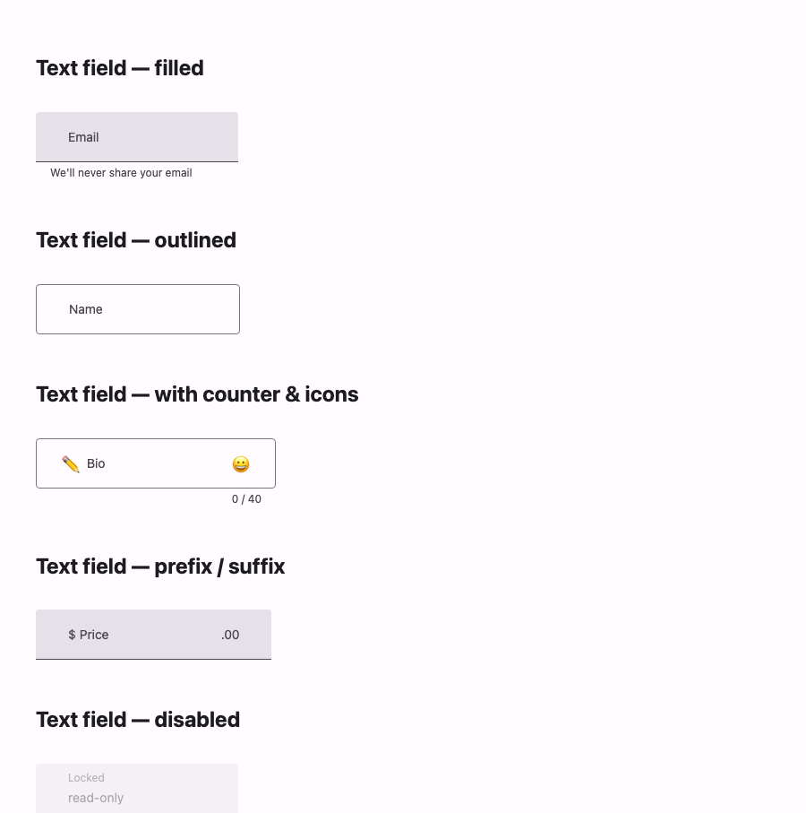

# @lit-material/text-field

Material Design 3 text field web components built with [Lit](https://lit.dev/):
`lit-material-text-field` (single-line) and `lit-material-textarea` (multi-line), sharing the same
floating-label/filled/outlined/error-state/character-counter design. Part of
[lit-material](https://github.com/bohdaq/lit-material).




Filled and outlined variants with a floating label, supporting/helper text, error states, a
character counter, and native form participation. `lit-material-text-field` additionally has
prefix/suffix text and leading/trailing icon slots — not part of `lit-material-textarea`, which has
no sensible place to put them across multiple rows.

## Install

```sh
npm install @lit-material/text-field @lit-material/tokens
```

## Usage

```html
<link rel="stylesheet" href="node_modules/@lit-material/tokens/css/index.css" />
<script type="module">
  import "@lit-material/text-field";
</script>

<lit-material-text-field variant="filled" label="Email" type="email" supporting-text="We'll never share it"></lit-material-text-field>

<lit-material-text-field variant="outlined" label="Name" required error error-text="Required"></lit-material-text-field>

<lit-material-text-field variant="outlined" label="Bio" maxlength="40">
  <span slot="leading-icon" aria-hidden="true">✏️</span>
</lit-material-text-field>

<lit-material-text-field variant="filled" label="Price" prefix="$" suffix=".00" type="number"></lit-material-text-field>

<lit-material-textarea variant="outlined" label="Comments" rows="4" maxlength="280"></lit-material-textarea>
```

## `lit-material-text-field` API

| Property          | Attribute          | Type                 | Default    |
| ----------------- | ------------------ | -------------------- | ---------- |
| `variant`         | `variant`          | `"filled" \| "outlined"` | `"filled"` |
| `value`           | `value`            | `string`             | `""`       |
| `label`           | `label`            | `string`             | `""`       |
| `placeholder`     | `placeholder`      | `string`             | `""`       |
| `supportingText`  | `supporting-text`  | `string`             | `""`       |
| `errorText`       | `error-text`       | `string`             | `""`       |
| `error`           | `error`            | `boolean`            | `false`    |
| `disabled`        | `disabled`         | `boolean`            | `false`    |
| `required`        | `required`         | `boolean`            | `false`    |
| `readonly`        | `readonly`         | `boolean`            | `false`    |
| `prefix`          | `prefix`           | `string`             | `""`       |
| `suffix`          | `suffix`           | `string`             | `""`       |
| `type`            | `type`             | `string`             | `"text"`  |
| `min`             | `min`              | `number \| undefined`| `undefined`|
| `max`             | `max`              | `number \| undefined`| `undefined`|
| `minlength`       | `minlength`        | `number \| undefined`| `undefined`|
| `maxlength`       | `maxlength`        | `number \| undefined`| `undefined`|
| `step`            | `step`             | `string`             | `""`       |
| `pattern`         | `pattern`          | `string`             | `""`       |
| `autocomplete`    | `autocomplete`     | `string`             | `""`       |
| `inputmode`        | `inputmode`        | `string`             | `""`       |
| `name`            | `name`             | `string`             | `""`       |
| `form`            | `form`             | `string \| undefined`| `undefined`|

Slots: `leading-icon`, `trailing-icon`.

## `lit-material-textarea` API

| Property          | Attribute          | Type                                              | Default    |
| ----------------- | ------------------ | -------------------------------------------------- | ---------- |
| `variant`         | `variant`          | `"filled" \| "outlined"`                            | `"filled"` |
| `value`           | `value`            | `string`                                            | `""`       |
| `label`           | `label`            | `string`                                            | `""`       |
| `placeholder`     | `placeholder`      | `string`                                            | `""`       |
| `supportingText`  | `supporting-text`  | `string`                                            | `""`       |
| `errorText`       | `error-text`       | `string`                                            | `""`       |
| `error`           | `error`            | `boolean`                                           | `false`    |
| `disabled`        | `disabled`         | `boolean`                                           | `false`    |
| `required`        | `required`         | `boolean`                                           | `false`    |
| `readonly`        | `readonly`         | `boolean`                                           | `false`    |
| `minlength`       | `minlength`        | `number \| undefined`                               | `undefined`|
| `maxlength`       | `maxlength`        | `number \| undefined`                               | `undefined`|
| `rows`            | `rows`             | `number`                                            | `4`        |
| `resize`          | `resize`           | `"none" \| "vertical" \| "horizontal" \| "both"`    | `"vertical"` |
| `autocomplete`    | `autocomplete`     | `string`                                            | `""`       |
| `name`            | `name`             | `string`                                            | `""`       |
| `form`            | `form`             | `string \| undefined`                               | `undefined`|

No slots — a multi-line body-text field has no natural place for inline icons or prefix/suffix
text the way a single-line one does.

## `lit-material-number-field`

A number with − and + buttons beside it, for replicas, cores, gigabytes:

```html
<lit-material-number-field label="Disk" unit="GiB" value="20" min="10" max="500" step="10"></lit-material-number-field>
```

ArrowUp/ArrowDown step, PageUp/PageDown step by ten, Home/End jump to `min`/`max`. The buttons
disable at the ends of the range. Text that isn't a number, or is out of range, shows "Enter a
number", "At least 10" or "At most 500" under the field; `value` keeps the last good number and
is `null` while the field is empty. Steps don't drift (`0.1` + `0.2` is `0.3`). From an empty
field the first step lands on `min` (or `0`).

| Property         | Attribute         | Type                      | Default      |
| ---------------- | ----------------- | ------------------------- | ------------ |
| `value`          | `value`           | `number \| null`          | `null`       |
| `min`, `max`     | `min`, `max`      | `number`                  | —            |
| `step`           | `step`            | `number`                  | `1`          |
| `label`          | `label`           | `string`                  | `""`         |
| `unit`           | `unit`            | `string` (field suffix)   | `""`         |
| `variant`        | `variant`         | `"filled" \| "outlined"`  | `"outlined"` |
| `supportingText` | `supporting-text` | `string`                  | `""`         |
| `errorText`      | `error-text`      | `string` (your own error) | `""`         |
| `name`, `required`, `disabled`, `readonly` | same | — | — |

Methods: `stepBy(count)`, `checkValidity()`; `validationMessage` holds the field's own error.
Events: `input` while typing a number, `change` after a step or a committed edit. Parts:
`field`, `decrement`, `increment`. `--lit-material-number-field-width` sets the field's
smallest width (default `8ch`).

## Behavior

The label floats when the field is focused, holds a value, or has a placeholder. A character
counter renders when `maxlength` is set. Pressing Enter in `lit-material-text-field` submits its form, as with a native input. Both are form-associated via `ElementInternals`
(participate in `FormData`, validation, and form reset) and forward native constraint validation:
set `error`/`error-text` for custom errors, or rely on `required`/`minlength`/etc., which surface an
error state after the field is blurred (touched).

`lit-material-textarea`'s resting label sits near the top of the box (roughly where the first typed
line would go) rather than vertically centering — unlike a single-line field, there's no sensible
"middle" to center it in once the box is several rows tall.

## Styling

The outlined variant's floating label sits on a patch of `--lit-material-text-field-notch-color`
(default `--md-sys-color-surface`) that hides the outline behind it. On another surface, set it to
match: `lit-material-text-field { --lit-material-text-field-notch-color: var(--md-sys-color-surface-container-low); }`.
`lit-material-dialog` sets it for fields in its body.

A field is at least `--lit-material-text-field-min-width` wide (default `210px`). Set it to `0`
(and `width: 100%`) to let a grid or flex cell make it narrower.

## License

MIT
