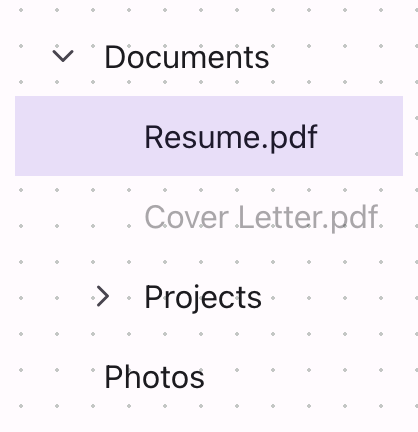

# @lit-material/tree

Material Design 3-styled hierarchical tree web components built with [Lit](https://lit.dev/). Part
of [lit-material](https://github.com/bohdaq/lit-material).

Two elements: `lit-material-tree-item` (a node — chevron if it has children, optional leading icon,
label, and arbitrarily nested children) and `lit-material-tree` (groups nodes, adding single- or
multi-select coordination and arrow-key navigation across every *visible* node), following the
WAI-ARIA [Tree View](https://www.w3.org/WAI/ARIA/apg/patterns/treeview/) pattern.



## Install

```sh
npm install @lit-material/tree @lit-material/tokens
```

## Usage

```html
<link rel="stylesheet" href="node_modules/@lit-material/tokens/css/index.css" />
<script type="module">
  import "@lit-material/tree";
</script>

<lit-material-tree id="files">
  <lit-material-tree-item expanded>
    <span slot="label">Documents</span>
    <lit-material-tree-item selected>
      <span slot="label">Resume.pdf</span>
    </lit-material-tree-item>
    <lit-material-tree-item>
      <span slot="label">Cover Letter.pdf</span>
    </lit-material-tree-item>
  </lit-material-tree-item>
  <lit-material-tree-item>
    <span slot="label">Photos</span>
  </lit-material-tree-item>
</lit-material-tree>
<script type="module">
  document.getElementById("files").addEventListener("change", (event) => {
    // Inspect .selected on the tree's lit-material-tree-item descendants.
  });
</script>
```

## `lit-material-tree` API

| Property   | Attribute  | Type      | Default |
| ---------- | ---------- | --------- | ------- |
| `multiple` | `multiple` | `boolean` | `false` |
| `reorderable` | `reorderable` (reflected) | `boolean` | `false` |

Slot: default (top-level `lit-material-tree-item` elements — nest more inside each item for
deeper levels). Fires `change` when the selection changes via user interaction. `multiple` allows
more than one node selected at once (each click toggles that node); by default, selecting a node
deselects whatever else was selected anywhere in the tree, not just its immediate siblings.

## `lit-material-tree-item` API

| Property   | Attribute  | Type      | Default |
| ---------- | ---------- | --------- | ------- |
| `expanded` | `expanded` | `boolean` | `false` |
| `selected` | `selected` | `boolean` | `false` |
| `disabled` | `disabled` | `boolean` | `false` |
| `droppable` | `droppable` (reflected) | `boolean` | `false` |

Slots: `label`, `leading` (an optional icon), default (nested `lit-material-tree-item` children).
Fires `toggle` (`detail: { expanded }`) when `expanded` changes via user interaction. `expanded` is
this node's own concern (click the chevron, or ArrowRight/Left); `selected` is always managed by
the parent `lit-material-tree` — set directly only for the initial state, since single-select mode
needs to be able to clear it from anywhere else in the tree. `lit-material-tree-item` isn't meant
to be used standalone the way `lit-material-accordion-panel` is: `role="treeitem"` requires a
`tree` or `group` role ancestor per ARIA, which only a wrapping `lit-material-tree` (or another
`lit-material-tree-item`) provides.

## Decorations, actions and reordering

A tree item's `trailing` slot holds decorations after the label (a git status letter, a method
tag, a count); its `actions` slot holds buttons that show while the row is hovered or has focus
inside (always on touch screens). Clicking an action doesn't select the row; give each an
`aria-label`.

```html
<lit-material-tree-item>
  <span slot="label">create-order.yaml</span>
  <span slot="trailing">M</span>
  <lit-material-icon-button slot="actions" aria-label="Rename">…</lit-material-icon-button>
</lit-material-tree-item>
```

Rows follow the `--md-sys-density-tree-item-min-height` token (28 px under `density="compact"`).

## Drag and drop

`reorderable` on the tree turns on moving nodes, by pointer or keyboard:

- **Drag** a node once the pointer has moved 5 px (a plain click still selects). Over another
  node's row the top half means *before* it and the bottom half *after* it; over a node marked
  `droppable` (a folder) the top and bottom quarters mean before and after and the middle means
  *inside* it, as its last child. A line shows a before/after place, a highlighted row an inside
  one; a label follows the pointer. A collapsed droppable node held over for 600 ms opens. Near
  the edges of the nearest scrolling container (the tree, a sidebar, the page) the container
  scrolls. Escape cancels. A node can't go onto or into itself.
- **Keyboard:** `Alt+ArrowUp`/`ArrowDown` move the focused node past its previous/next sibling,
  `Alt+ArrowLeft` moves it out of its parent (right after it) and `Alt+ArrowRight` into the
  droppable sibling above it (which opens). Right to left, Left and Right swap. The tree's
  `aria-description` mentions the keys.
- Each move is announced through a polite live region ("create-order.yaml moved into payments").

The tree fires a cancelable `move` event, `detail: {item, target, place}` (`TreeMoveDetail`;
`place` is `"before"`, `"after"` or `"inside"`), and moves nothing itself: move your data and
render again, keyed (Lit's `repeat`, React keys), so the moved node keeps its element. Focus stays
on it, and its indentation and ARIA position follow.

```js
tree.addEventListener("move", (e) => {
  const { item, target, place } = e.detail;
  files = moveFile(files, item.dataset.id, target.dataset.id, place);
  render();
});
```

For compatibility, a move that keeps the node among its siblings is followed by the older
`reorder` event (`detail: {item, parent, from, to}`: indexes among the siblings) unless `move` was
cancelled, and `Alt+Shift+ArrowUp`/`ArrowDown` still fire only `reorder`. Handle one of the two.

Dropping something else on the tree (a tab dragged out of `lit-material-tabs`): call
`tree.dropPlaceAt(item, clientY)` for the place under the pointer (`{target, place}` or `null`;
pass `null` as `item` for something that isn't a node), `tree.showDropIndicator(place)` to show
it, and `showDropIndicator(null)` when done. `endDrag()` cancels a pointer drag in progress.

The drop line and the inside highlight use `--lit-material-tree-drop-indicator-color` (default
`--md-sys-color-primary`); parts `drop-line` and `drag-ghost` style the rest.

## Behavior

Clicking a node's row selects it; clicking its chevron (when it has children) only expands or
collapses it — the two are independent actions, and neither implies the other. A node's
indentation is derived purely from how many `lit-material-tree-item` ancestors it has, not a
property the tree manages.

## Keyboard interaction

Exactly one node has `tabindex="0"` at a time (roving tabindex, moved by the tree as focus moves).
Down/Up move focus to the next/previous *visible* node — collapsed branches' children are skipped
entirely — without wrapping past the first/last node, unlike `lit-material-tabs`' roving tabindex.
Right expands a collapsed branch (focus stays put) or moves focus into its first child if already
expanded; on a leaf node, it does nothing. Left is the mirror: collapses an expanded branch, or
moves focus to the parent node. Right to left, Left and Right swap (Left expands), and the chevron
points left. Home/End jump to the first/last visible node. Enter/Space select
the focused node — matching the exact WAI-ARIA Tree View keyboard spec. Typing jumps to the next
visible node whose label starts with what was typed.

With `reorderable`, Alt+Arrow keys move the focused node (see [Drag and drop](#drag-and-drop)).

## License

MIT
